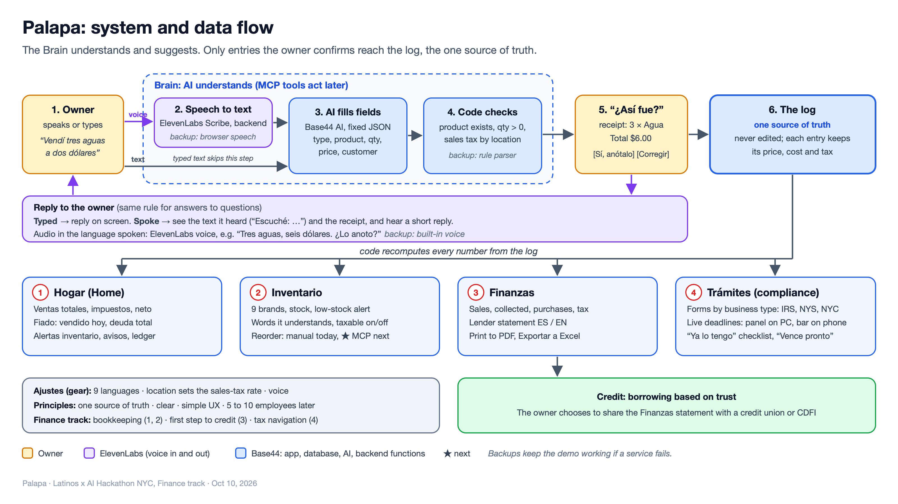

# Palapa

**Habla. Confirma. Listo.** A cash register you talk to, for corner stores (bodegas) and other businesses that run on cash in New York.

- Landing page: https://siddhant-rajhans.github.io/palapa/
- Live app: https://palapa.base44.app

## What it does

The owner says or types what happened, in Spanish, English or both ("Vendí tres aguas a dos dólares"). Palapa shows a receipt with what it understood and what will change, and after "Sí, anótalo" it updates cash, stock, store credit (fiado) and sales tax together.

- **Hogar:** total sales, tax and net; what was sold on credit; inventory alerts; today's ledger with undo.
- **Fiado:** who owes what, their history, and recording payments.
- **Inventario:** nine corner-store brands with price, cost, stock, the words the voice understands, and a taxable switch.
- **Trámites:** the tax forms, registrations, licenses and deadlines that apply to each type of business, from 31 official IRS, New York State and New York City items, with live deadlines.
- **Finanzas:** a self-reported monthly statement a lender can review, in Spanish or English, printable as PDF and exportable to Excel.
- **Ajustes:** nine languages, business location (sets the sales-tax rate), voice, text alerts.

## How it works

The AI only turns words into fields (product, quantity, price, customer). Plain code checks them and calculates every dollar from an append-only log: entries are never edited, undo marks a line as undone, and each entry keeps the price, cost and tax of its moment.

Built on [Base44](https://base44.com) (app, database, AI parsing, backend functions) with [ElevenLabs](https://elevenlabs.io) for speech-to-text and voice replies, and the browser's speech as a backup. Full feature list: [docs/features.md](docs/features.md). Compliance items with official links: [docs/compliance-items.md](docs/compliance-items.md).

## Team

Siddhant Rajhans, Gabriel Smith and Engin Deniz Doğu, at the Latinos x AI Hackathon NYC (Columbia Business School, October 10, 2026), Finance track.

Trámites is general information, not legal or tax advice. The demo uses sample data.
